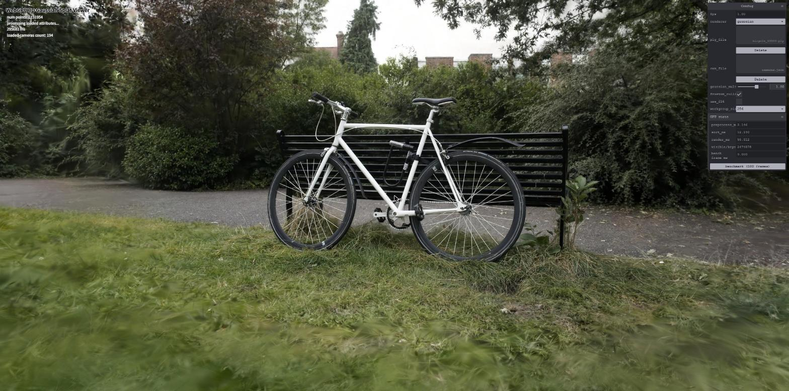
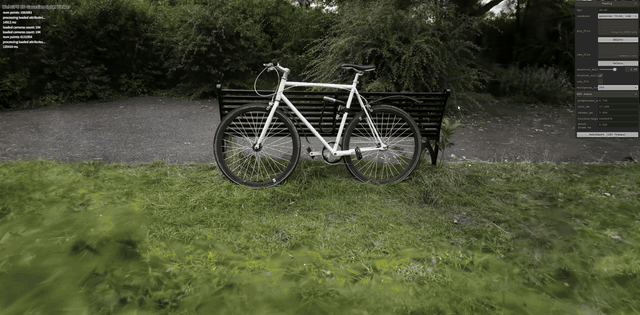
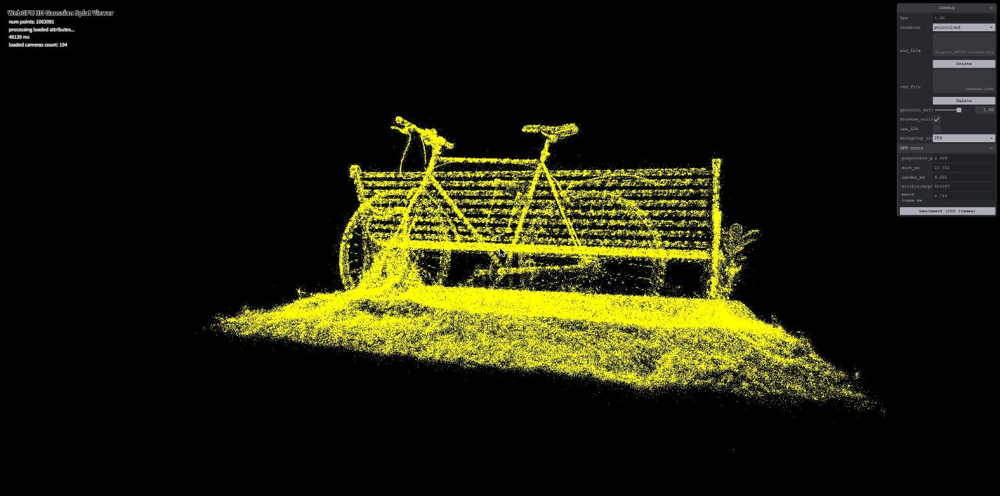
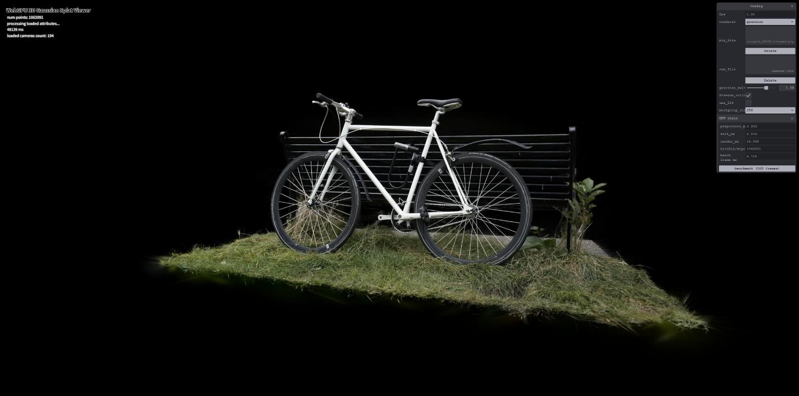
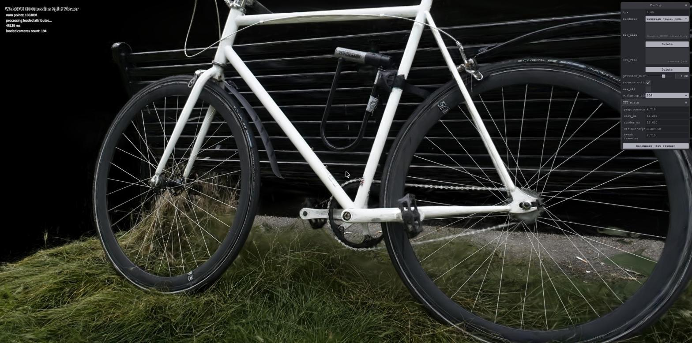
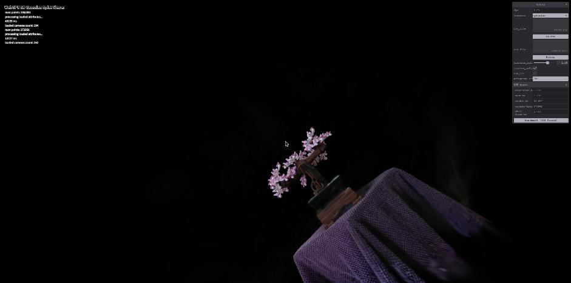

# Project5-WebGPU-Gaussian-Splat-Viewer

**University of Pennsylvania, CIS 565: GPU Programming and Architecture, Project 5**

* Weike Qian
* Tested on: **Google Chrome 155.0.8059.82** on Windows 11, i9-13980HX @ 2.20GHz 32GB, NVIDIA GeForce RTX 4080 Laptop GPU 12GB (personal laptop)

### Live Demo

[rev3nus.github.io/CIS-5650-Project5](https://rev3nus.github.io/CIS-5650-Project5/)

[](https://rev3nus.github.io/CIS-5650-Project5/)

*Full bicycle scene (6.1M gaussians) at 2560×1271, about 25 ms per frame.*

### Demo GIF



## Overview

A WebGPU viewer for pretrained [3D Gaussian Splatting](https://repo-sam.inria.fr/fungraph/3d-gaussian-splatting/) scenes. You can switch between three renderers in the GUI:

- `pointcloud`: draws each gaussian center as a yellow point.
- `gaussian`: compute shader preprocess, GPU radix sort by depth, then one alpha-blended quad per gaussian drawn back to front with an indirect draw call.
- `gaussian (tile, compute)`: the tile-based version from the original paper. Gaussians are sorted per 16×16 tile and a compute shader blends each tile front to back.

Features:

- Point cloud renderer with the MVP transform (Part 1)
- Gaussian renderer: frustum culling, 3D/2D covariance, SH color, depth sort, indirect quad rendering (Part 2)
- Extra credit: tile-based depth sorting with compute shader compositing
- Extra credit: half-precision (f16) preprocess shader
- GPU timing panel and a benchmark button, used for the performance analysis

| Point cloud | Gaussian |
|---|---|
|  |  |

| Tile renderer, close-up | Bonsai |
|---|---|
|  |  |

### Usage

Pick a `.ply` scene and its `cameras.json` in the panel on the top right. Keys `0`–`9` jump to the camera presets. Left drag rotates, right drag pans, and the scroll wheel moves forward and back.

| Option | What it does |
|---|---|
| `gaussian_multiplier` | Scales every gaussian before the covariance is built. |
| `frustum_culling` | Turns the 1.2× screen-space culling on or off. Gaussians behind the near plane are always dropped. |
| `use_f16` | Runs the preprocess shader in half precision. Needs `shader-f16`. |
| `workgroup_size` | Workgroup size of the preprocess shader (32, 64, 128 or 256). |
| GPU stats | Per-stage GPU times from timestamp queries, and the number of visible gaussians (or tile keys for the tile renderer). |
| benchmark | Renders 100 frames back to back and shows the average frame time. Stage averages go to the console. |

## Implementation

### Part 1: Point Cloud

The vertex shader in `point_cloud.wgsl` now transforms each point by `proj * view * pos`.

### Part 2: Gaussian Renderer

#### Preprocess (`preprocess.wgsl`)

One thread per gaussian:

1. Unpack position, opacity, rotation and scale from f16.
2. Frustum culling. Gaussians with view-space `z` outside `[0.2, 100]` are dropped. With culling on, I also drop gaussians whose NDC center is outside a 1.2× box, so the ones just past the edge of the screen still show up.
3. 3D covariance `Σ = R S Sᵀ Rᵀ`, with `R` from the normalized quaternion and `S = exp(scale) * gaussian_multiplier`. Opacity goes through a sigmoid.
4. 2D covariance `Σ' = J W Σ Wᵀ Jᵀ`, where `W` is the view rotation and `J` is the Jacobian of the projection. Like the reference code, the point is clamped to 1.3× the FOV before computing `J`, and 0.3 is added to the diagonal as a low-pass filter.
5. Conic `Σ'⁻¹`, radius `ceil(3 * sqrt(λ_max))` in pixels, and quad half size in NDC `radius * 2 / viewport`.
6. Color: `sh_coef` reads the coefficients from `sh_buffer` (16 × RGB in f16 per gaussian) and `computeColorFromSH` evaluates them for the view direction, up to degree 3.
7. Write a 32-byte splat: NDC center and conic in f32, quad size and color/opacity packed with `pack2x16float`.
8. Reserve a sort slot with `atomicAdd` on `keys_size` and write the index and depth key. The key is `bitcast<u32>(zfar - z)`: positive floats keep their order when compared as u32, and since the radix sort is ascending, far splats end up first. `dispatch_x` is incremented every time a new block of 256 × 15 keys starts.

The dispatch is 2D, because the full bicycle scene needs more than 65535 workgroups.

#### Sorting and drawing (`gaussian-renderer.ts`)

Each frame I reset `keys_size` and `dispatch_x`, run the preprocess pass and the provided radix sort, copy `keys_size` into the instance count of the indirect buffer with `copyBufferToBuffer`, and call `drawIndirect` with a 4-vertex triangle strip per instance.

#### Rendering (`gaussian.wgsl`)

The vertex shader reads `splats[sort_indices[instance_index]]` and builds the quad around the splat center. The fragment shader takes the pixel offset `d` from the center and computes

```
power = -0.5 * (a * dx² + c * dy²) - b * dx * dy
alpha = min(0.99, opacity * exp(power))
```

discarding fragments with `power > 0` or `alpha < 1/255`. It outputs premultiplied color, blended with `(one, one-minus-src-alpha)`. The instructions mention flipping x for the offset. With this camera setup I didn't need to, because pixel y and camera-space y both point down, so the conic can be used on pixel offsets as is.

### Part 3: Extra Credit

#### Tile-based depth sorting (`gaussian-tile-renderer.ts`, `tile_raster.wgsl`)

This follows the structure of the original CUDA rasterizer:

1. `preprocess_tiles` (in `preprocess.wgsl`) finds the 16×16 tiles a splat's radius covers and emits one key per tile: `tile_id << depth_bits | depth`. The provided sorter only does 32-bit keys, so `depth_bits = 32 - ceil(log2(#tiles))` and depth is quantized to that.
2. `finalize` clamps the key count to the buffer size and writes the indirect dispatch sizes for the sort and the next pass.
3. Radix sort. Keys end up grouped by tile and ordered front to back inside each tile.
4. `identify_ranges` finds the `[start, end)` range of each tile.
5. `rasterize` runs one 16×16 workgroup per tile. The threads load 256 gaussians at a time into shared memory, and every pixel blends them front to back (`C += c * α * T`). A pixel stops once `T < 1e-4`, and the whole workgroup stops once all its pixels are done. The result is written to a storage texture and copied to the canvas.

The number of keys is only known on the GPU, so it is read back asynchronously. If it was larger than the buffers, they are reallocated at 1.5× the size (up to the device limits, and about 1.5 GB at most). The tile renderer is only created the first time you select it, since it needs a lot of memory.

#### Half-precision preprocess (`use_f16`)

`preprocess.wgsl` uses `real` as its float type. The host compiles it twice, once with `alias real = f32` and once with `enable f16; alias real = f16`. In the f16 version the rotation matrix, `exp(scale)`, `R * S`, the sigmoid and the whole SH evaluation run in half precision. `Σ` and everything after it stay in f32, because the variances in pixel² overflow f16 (max 65504) very easily. `shader-f16` is only requested if the adapter supports it. Otherwise the checkbox shows `(n/a)`.

## Performance Analysis

### Setup

- Times come from the benchmark mode: 30 warm-up frames, then the average of 60 frames rendered back to back.
- `preprocess`, `sort` and `render` are GPU timestamps. `sort` is the time between preprocess and rendering, so for the tile renderer it also includes `finalize` and `identify_ranges`. For the tile renderer, `render` is the `rasterize` pass.
- `frame` is the time from `submit` to `onSubmittedWorkDone`. It has about 4 ms of fixed overhead: the point cloud, which does almost nothing, already measures about 4 ms.
- Canvas 2560 × 1271, camera preset 0, f32, workgroup size 256, culling on, unless noted.
- I didn't measure inside the normal `requestAnimationFrame` loop. There the frame rate is capped by vsync, and in a background tab Chrome throttles it to about 1 fps. The laptop GPU then clocks down, and the stage times came out about 4× too high.

### 1. Point cloud vs. gaussian renderer

All times in ms.

| Scene (#gaussians) | Renderer | preprocess | sort | render | frame | sorted keys |
|---|---|---|---|---|---|---|
| bonsai (272,956) | pointcloud | – | – | – | 3.99 | – |
| bonsai (272,956) | gaussian | 0.12 | 0.83 | 1.14 | 4.99 | 271,962 |
| bonsai (272,956) | tile | 0.37 | 1.89 | 1.49 | 7.06 | 1,238,054 |
| bicycle cleaned (1,063,091) | pointcloud | – | – | – | 4.20 | – |
| bicycle cleaned (1,063,091) | gaussian | 0.57 | 1.61 | 9.03 | 14.69 | 1,063,091 |
| bicycle cleaned (1,063,091) | tile | 1.47 | 13.27 | 7.29 | 25.95 | 9,906,244 |
| bicycle full (6,131,954) | pointcloud | – | – | – | 4.01 | – |
| bicycle full (6,131,954) | gaussian | 1.50 | 3.67 | 16.86 | 25.35 | 2,474,578 |
| bicycle full (6,131,954) | tile | 4.94 | 24.18 | 13.26 | 45.74 | 18,394,982 |
| bicycle cleaned, close-up | gaussian | 0.45 | 1.30 | 43.53 | 48.63 | 864,771 |
| bicycle cleaned, close-up | tile | 4.78 | 46.22 | 22.54 | 77.85 | 35,309,950 |

The point cloud only shows the gaussian centers as single yellow pixels. You can make out the bike and the bench, but there is no color or surface and you can see through everything. The gaussian renderer looks like the original photos. The splats are anisotropic and semi-transparent with view-dependent color, so they blend into solid surfaces, and thin things like the spokes, the brake cable and grass come out well. Up close you can even read the text on the tire.

Performance-wise the point cloud costs nothing beyond the 4 ms overhead. The gaussian renderer adds a preprocess pass (covariance plus 48 SH coefficients per gaussian), a full sort of all visible gaussians every frame, and a render pass with a lot of transparent overdraw. Rendering is the biggest part: about 9 of the 11 ms of GPU time on bicycle. In the close-up it goes up to 43.5 ms even though fewer gaussians are visible, because each splat covers many more pixels.

The tile renderer composites faster than hardware blending, 22.5 vs 43.5 ms in the close-up. It reads each gaussian once per tile into shared memory and stops pixels that are already opaque, while the quad renderer blends every fragment. But each gaussian now makes one key per tile it touches, 9.3× more keys than gaussians at the default view and 41× more in the close-up. Sorting 10 to 35 million 32-bit keys takes 13 to 46 ms, more than the rasterizer saves, so the tile renderer ends up slower overall here. Fewer key bits, a per-tile sort, or a tighter footprint than a square around 3σ would be the next things to try.

### 2. Workgroup size

Preprocess time in ms, bicycle cleaned, default view:

| workgroup size | f32 | f16 |
|---|---|---|
| 32 | 0.591 | 0.542 |
| 64 | 0.551 | 0.554 |
| 128 | 0.555 | 0.573 |
| 256 | 0.553 | 0.557 |

Bicycle full (6.1M gaussians) with culling off, so every thread does the full work:

| workgroup size | f32 | f16 |
|---|---|---|
| 32 | 2.217 | 2.198 |
| 64 | 2.092 | 2.209 |
| 128 | 2.116 | 2.228 |
| 256 | 2.240 | 2.189 |

The workgroup size makes almost no difference. Even with 6.1M gaussians everything is within 2.09 to 2.24 ms, which is about the run-to-run noise. There's no size that is consistently faster or slower across the two scenes.

I think this is because preprocess is memory bound. Each thread reads 24 B of gaussian data and 96 B of SH coefficients, writes a 32 B splat and a key, and does fairly little math per byte. Threads also don't share anything through workgroup memory. So as long as enough threads are running to hide the memory latency, how they are grouped doesn't matter much.

f16 isn't faster either, for the same reason. The math it speeds up isn't the bottleneck, and the extra conversions between f16 and f32 eat whatever is gained.

### 3. View-frustum culling

Times in ms.

| View | Renderer | culling | visible / keys | preprocess | sort | render | frame |
|---|---|---|---|---|---|---|---|
| turned away (most of the scene off screen) | gaussian | on | 212,060 | 0.20 | 0.58 | 1.00 | 5.01 |
| turned away | gaussian | off | 1,063,091 | 0.51 | 1.59 | 1.14 | 6.47 |
| turned away | tile | on | 818,288 | 0.23 | 1.29 | 1.00 | 5.30 |
| turned away | tile | off | 824,287 | 0.60 | 1.36 | 1.09 | 6.71 |
| bicycle full, default view | gaussian | on | 2,474,578 | 1.50 | 3.67 | 16.86 | 25.35 |
| bicycle full, default view | gaussian | off | 4,306,690 | 2.11 | 6.12 | 17.60 | 29.11 |
| close-up | gaussian | on | 864,771 | 0.45 | 1.30 | 43.53 | 48.63 |
| close-up | gaussian | off | 1,062,992 | 0.55 | 1.60 | 43.68 | 49.49 |

It helps, roughly in proportion to how much of the scene is off screen. Turned away, culling removes 80% of the gaussians. Preprocess gets 2.6× faster because culled threads return before the covariance and SH work, the sort gets 2.7× faster because there are fewer keys, and the frame goes from 6.5 to 5.0 ms.

In the full bicycle scene, 43% of the gaussians in front of the camera are outside the 1.2× box even at the default view (trees and the path around the camera). Culling them saves 3.8 ms per frame (13%), mostly in the sort.

The render pass hardly changes, because the GPU clips off-screen quads anyway and they never produce fragments. Culling only saves their vertex work. In the close-up only 19% get culled and the frame is fill-rate bound, so the gain is under 2%. With the whole scene in view there's nothing to cull, and the test costs almost nothing.

For the tile renderer the key count barely changes. An off-screen gaussian covers zero tiles, so it never emitted keys in the first place. Only preprocess gets faster.

### 4. Number of gaussians

Same camera (bicycle preset 0) for the two bicycle files, bonsai for reference. Times in ms.

| Scene | #gaussians | visible | preprocess | sort | render | frame |
|---|---|---|---|---|---|---|
| bonsai | 272,956 | 271,962 | 0.12 | 0.83 | 1.14 | 4.99 |
| bicycle cleaned | 1,063,091 | 1,063,091 | 0.57 | 1.61 | 9.03 | 14.69 |
| bicycle full | 6,131,954 | 2,474,578 | 1.50 | 3.67 | 16.86 | 25.35 |

Yes. Preprocess scales with the total count, since every gaussian is read even if it gets culled. The sort scales with the number of visible keys. Rendering scales with the number of visible splats times the pixels they cover, because overdraw adds up with transparency.

The full bicycle is the same scene as the cleaned one but with the background kept. Going from 1.06M to 6.13M gaussians, preprocess goes up 2.6×, sort 2.3× (2.3× more visible keys) and render 1.9×, and the frame goes from 14.7 to 25.4 ms. That's less than linear, because 60% of the full scene is behind the camera or off screen and gets culled before sorting and rendering. Without culling, all 4.3M gaussians in front of the camera get processed and the frame takes 29.1 ms.

The count isn't everything though. The close-up has fewer visible gaussians than the default view, but its render pass takes 4.8× longer (3.3× for the whole frame) because each splat covers more pixels. Screen coverage matters about as much as the number of gaussians.

## Credits

- [Vite](https://vitejs.dev/)
- [tweakpane](https://tweakpane.github.io/docs//v3/monitor-bindings/)
- [stats.js](https://github.com/mrdoob/stats.js)
- [wgpu-matrix](https://github.com/greggman/wgpu-matrix)
- Special Thanks to: Shrek Shao (Google WebGPU team) & [Differential Guassian Renderer](https://github.com/graphdeco-inria/diff-gaussian-rasterization)
- References: [kwea123's gaussian splatting notes](https://github.com/kwea123/gaussian_splatting_notes), [SH post](https://beatthezombie.github.io/sh_post_1/)
